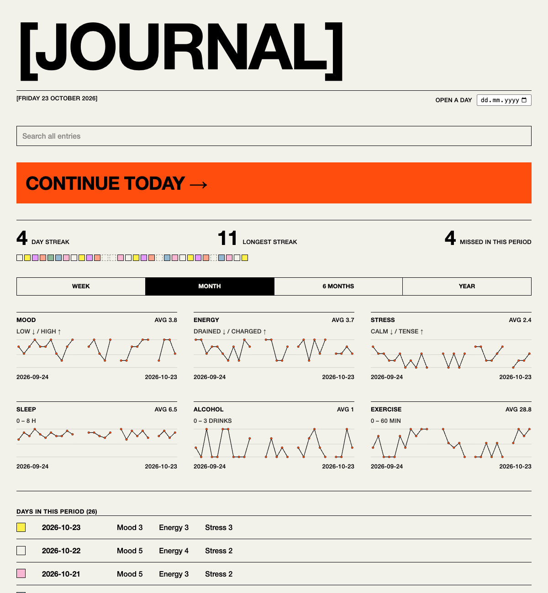

# Journal

A small journal that runs on your own computer. Each day has a few short prompts drawn from common psychological practices, and a home page shows how your mood, energy and stress have moved over the past week, month, six months or year.



## What it does

Each day has eight sections:

- **Check-in:** mood, energy and stress, each on a 1 to 5 scale
- **Body & habits:** sleep, alcohol and exercise
- **Gratitude:** three things that went well
- **The day:** what happened, emotion tags, and how you felt
- **Pictures:** photos with captions
- **Thought record:** examine one difficult thought (CBT)
- **Self-compassion:** what you would say to a friend
- **Tomorrow:** one intention

You can pick a page colour for each day. Entries save as you type.

The home page shows each number over the past week, month, six months or year. It also shows your current and longest streak, and a strip of squares that marks the days you missed. Search finds any word across all entries.

**Export PDF** opens a white print version of the day in the same style. Choose "Save as PDF" in the print dialog.

## Getting started

You need Python 3.12+ and [uv](https://docs.astral.sh/uv/).

```
git clone <this repo>
cd journal
uv run journal
```

Then open http://127.0.0.1:5000. The **Close** button saves and stops the app.

## Your data

Everything stays on your machine, in `data/`: one JSON file per day, plus pictures under `data/images/`. The folder is git-ignored. Set `JOURNAL_DATA_DIR` to keep it somewhere else.

Because entries are plain JSON, they are easy to read with other tools. `GET /api/entries` returns all of them.

## Changing the prompts

The prompts live in `src/journal/schema.py`. Add a `Field` to a section and it appears in the form, gets validated and is saved. Entries written before the change still open. New 1 to 5 scales also get their own chart on the home page.

## Tests

```
uv run pytest
```

## License

See [LICENSE](LICENSE).
